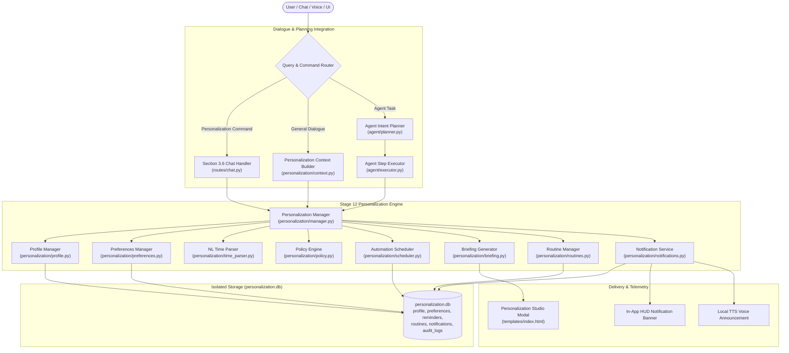

# STAGE 12 — ADVANCED PERSONALIZATION & PROACTIVE INTELLIGENCE

## 1. Overview & Architectural Goals
Stage 12 transforms **TONY AI** from a reactive command-response assistant into an adaptive, context-aware, proactive JARVIS-style companion. It introduces structured user profile management, granular preference tracking, a natural language scheduling engine, a persistent background scheduler, grounded daily briefings, multi-step routines, and strict proactive safety governance.

### Core Architectural Principles
1. **Strict Data Isolation:** All personalization, profile, reminder, routine, and proactive notification data is stored in `data/personalization/personalization.db`. Under no circumstances are reminder records or profile configs written into `data/memory.db` (Stage 4) or `data/knowledge/` (Stage 11).
2. **Controlled Proactive Behavior:** Proactive mode defaults to disabled (`PROACTIVE_ENABLED=false`). When activated, it operates under stringent safeguards: quiet hours enforcement (with overnight wrap-around support), daily rate limits (default: 5 actions/day), and consequential action gating.
3. **Passive Data Boundary & Injection Defense:** User-supplied reminder titles, descriptions, and preference values are treated as untrusted passive data. They are never executed as system commands or shell scripts. Prompt injection patterns (e.g., `ignore previous instructions`, `format disk`) are neutralized via regex substitution before storage.
4. **Grounded Synthesis (Zero Hallucination):** Morning briefings and evening summaries synthesize exclusively from authentic local system telemetry, registered reminders, and actual database records. External appointments, weather, or unverified emails are never fabricated.
5. **Seamless Multi-Stage Interoperability:** Personalization context is injected compactly into Stage 1 LLM dialogue prompts, Stage 8 JARVIS HUD interface, Stage 10 multi-step agent planning/dispatch, and Stage 2 voice output.

---

## 2. Architecture & Data Flow



---

## 3. Component & File Catalog

| Component | Path | Responsibility |
| :--- | :--- | :--- |
| **Data Models** | [`personalization/models.py`](file:///C:/Users/GOKUL/Desktop/TONY_AI/personalization/models.py) | Dataclasses for `UserProfile`, `UserPreference`, `Reminder`, `Routine`, `Notification`, and enums |
| **Storage Engine** | [`personalization/storage.py`](file:///C:/Users/GOKUL/Desktop/TONY_AI/personalization/storage.py) | Dedicated SQLite manager (`personalization.db`) managing 7 tables with transactional safety |
| **Profile Manager** | [`personalization/profile.py`](file:///C:/Users/GOKUL/Desktop/TONY_AI/personalization/profile.py) | CRUD operations, validation, tone/verbosity preferences, and default factory reset |
| **Preferences Manager** | [`personalization/preferences.py`](file:///C:/Users/GOKUL/Desktop/TONY_AI/personalization/preferences.py) | Granular key-value preference store with categorization, source tracking, and confidence |
| **Time Parser** | [`personalization/time_parser.py`](file:///C:/Users/GOKUL/Desktop/TONY_AI/personalization/time_parser.py) | Natural language time parser supporting relative, explicit, recurring, and timezone rules |
| **Policy Engine** | [`personalization/policy.py`](file:///C:/Users/GOKUL/Desktop/TONY_AI/personalization/policy.py) | Enforces quiet hours (including overnight wraps), daily limits, prompt sanitization, safety gating |
| **Notification Service** | [`personalization/notifications.py`](file:///C:/Users/GOKUL/Desktop/TONY_AI/personalization/notifications.py) | Multi-channel alert delivery across In-App notification drawers and local Voice/TTS |
| **Automation Scheduler** | [`personalization/scheduler.py`](file:///C:/Users/GOKUL/Desktop/TONY_AI/personalization/scheduler.py) | Background thread executing reminders, recurrence rescheduling, snooze, and missed job recovery |
| **Briefing Generator** | [`personalization/briefing.py`](file:///C:/Users/GOKUL/Desktop/TONY_AI/personalization/briefing.py) | Grounded daily morning briefings and evening summaries synthesized from real system telemetry |
| **Routine Manager** | [`personalization/routines.py`](file:///C:/Users/GOKUL/Desktop/TONY_AI/personalization/routines.py) | Multi-step workflows (morning, study, evening) with policy-governed execution gates |
| **Context Builder** | [`personalization/context.py`](file:///C:/Users/GOKUL/Desktop/TONY_AI/personalization/context.py) | Dynamically compiles compact, relevant user directives for LLM prompt injection |
| **Central Manager** | [`personalization/manager.py`](file:///C:/Users/GOKUL/Desktop/TONY_AI/personalization/manager.py) | Central subsystem coordinator tying profile, scheduler, briefings, and telemetry together |
| **REST Blueprint** | [`routes/personalization.py`](file:///C:/Users/GOKUL/Desktop/TONY_AI/routes/personalization.py) | REST API endpoints under `/api/personalization/*` |
| **Agent Policies** | [`agent/policies.py`](file:///C:/Users/GOKUL/Desktop/TONY_AI/agent/policies.py) | Registration of Stage 12 action types in `HIGH_RISK_ACTIONS` and `LOW_RISK_ACTIONS` |
| **Agent Planner** | [`agent/planner.py`](file:///C:/Users/GOKUL/Desktop/TONY_AI/agent/planner.py) | Intent classification rules mapping reminder/briefing/proactive goals to agent plans |
| **Agent Executor** | [`agent/executor.py`](file:///C:/Users/GOKUL/Desktop/TONY_AI/agent/executor.py) | Step execution routing personalization actions to `PersonalizationManager` |
| **Chat Routing** | [`routes/chat.py`](file:///C:/Users/GOKUL/Desktop/TONY_AI/routes/chat.py) | Section 3.6 command routing and LLM context directive injection |
| **Personalization HUD UI** | [`templates/index.html`](file:///C:/Users/GOKUL/Desktop/TONY_AI/templates/index.html) | HUD button and modal with Profile, Preferences, Reminders, Routines, and Proactive tabs |
| **Personalization JS** | [`static/js/personalization.js`](file:///C:/Users/GOKUL/Desktop/TONY_AI/static/js/personalization.js) | Client controller for modal tabs, reminder actions, routine runs, and live badge telemetry |
| **Personalization Styling** | [`static/css/style.css`](file:///C:/Users/GOKUL/Desktop/TONY_AI/static/css/style.css) | HUD theme styling with cyan/purple accents, switch sliders, and status badges |
| **Unit & Integration Tests** | [`tests/test_personalization.py`](file:///C:/Users/GOKUL/Desktop/TONY_AI/tests/test_personalization.py) | 52 comprehensive unit and integration test cases passing 100% |
| **Live Acceptance Script** | [`scratch/live_acceptance_stage12.py`](file:///C:/Users/GOKUL/Desktop/TONY_AI/scratch/live_acceptance_stage12.py) | Complete verification script validating Tests A through Q |

---

## 4. Database Schema (`personalization.db`)

All data is housed in `data/personalization/personalization.db` across 7 normalized SQLite tables:

### 1. `profile`
```sql
CREATE TABLE IF NOT EXISTS profile (
    id TEXT PRIMARY KEY,
    data_json TEXT NOT NULL,
    updated_at TEXT NOT NULL
);
```

### 2. `preferences`
```sql
CREATE TABLE IF NOT EXISTS preferences (
    key TEXT PRIMARY KEY,
    value_json TEXT NOT NULL,
    category TEXT NOT NULL DEFAULT 'general',
    source TEXT NOT NULL DEFAULT 'explicit_user',
    confidence REAL NOT NULL DEFAULT 1.0,
    updated_at TEXT NOT NULL
);
CREATE INDEX IF NOT EXISTS idx_preferences_cat ON preferences(category);
```

### 3. `reminders`
```sql
CREATE TABLE IF NOT EXISTS reminders (
    id TEXT PRIMARY KEY,
    title TEXT NOT NULL,
    description TEXT,
    scheduled_time TEXT NOT NULL,
    recurrence TEXT NOT NULL,
    recurrence_interval_days INTEGER,
    timezone TEXT NOT NULL,
    enabled INTEGER NOT NULL DEFAULT 1,
    status TEXT NOT NULL,
    last_triggered_at TEXT,
    next_trigger_at TEXT,
    created_at TEXT NOT NULL,
    updated_at TEXT NOT NULL
);
CREATE INDEX IF NOT EXISTS idx_reminders_trigger ON reminders(enabled, next_trigger_at);
CREATE INDEX IF NOT EXISTS idx_reminders_status ON reminders(status);
```

### 4. `routines`
```sql
CREATE TABLE IF NOT EXISTS routines (
    id TEXT PRIMARY KEY,
    name TEXT NOT NULL,
    description TEXT,
    steps_json TEXT NOT NULL,
    schedule_time TEXT,
    recurrence TEXT NOT NULL,
    enabled INTEGER NOT NULL DEFAULT 1,
    created_at TEXT NOT NULL,
    updated_at TEXT NOT NULL
);
```

### 5. `notifications`
```sql
CREATE TABLE IF NOT EXISTS notifications (
    id TEXT PRIMARY KEY,
    title TEXT NOT NULL,
    message TEXT NOT NULL,
    channel TEXT NOT NULL,
    delivered_at TEXT NOT NULL,
    is_read INTEGER NOT NULL DEFAULT 0,
    metadata_json TEXT,
    source_type TEXT NOT NULL
);
CREATE INDEX IF NOT EXISTS idx_notif_delivered ON notifications(delivered_at);
CREATE INDEX IF NOT EXISTS idx_notif_read ON notifications(is_read);
```

### 6. `proactive_suggestions`
```sql
CREATE TABLE IF NOT EXISTS proactive_suggestions (
    id TEXT PRIMARY KEY,
    suggestion_type TEXT NOT NULL,
    title TEXT NOT NULL,
    description TEXT NOT NULL,
    proposed_action_json TEXT,
    status TEXT NOT NULL,
    created_at TEXT NOT NULL,
    cooldown_until TEXT
);
```

### 7. `audit_logs`
```sql
CREATE TABLE IF NOT EXISTS audit_logs (
    id INTEGER PRIMARY KEY AUTOINCREMENT,
    action TEXT NOT NULL,
    details_json TEXT NOT NULL,
    created_at TEXT NOT NULL
);
CREATE INDEX IF NOT EXISTS idx_audit_time ON audit_logs(created_at);
```

---

## 5. Natural Language Scheduling & Time Parser

The `NaturalLanguageTimeParser` translates arbitrary conversational phrases into timezone-aware timestamps and recurrence rules:

- **Relative Durations:**
  - `"in 15 minutes"`, `"in 2 hours"`, `"in 3 days"`, `"in 30 seconds"`
  - Calculates delta from reference time in target timezone.
- **Explicit Dates & Times:**
  - `"tomorrow at 9:00 am"`, `"today at 14:30"`, `"at 5pm"`, `"on 2026-10-05 10:00:00"`
  - Automatically handles 12-hour (am/pm) and 24-hour clocks.
- **Recurrence Expressions:**
  - `"daily"` / `"every day"` $\rightarrow$ `RecurrenceType.DAILY`
  - `"every weekday"` $\rightarrow$ `RecurrenceType.WEEKDAYS` (skips Saturday/Sunday)
  - `"every monday"`, `"every friday"` $\rightarrow$ `RecurrenceType.WEEKLY`
  - `"monthly"` / `"every month"` $\rightarrow$ `RecurrenceType.MONTHLY`
- **Fallback & Extraction:**
  - Strips leading reminder triggers (`"remind me to..."`, `"please remind me in..."`) to cleanly isolate the reminder title.
  - Defaults to $now + 1\text{ hour}$ when no time expression is detected.

---

## 6. Safety, Boundary & Policy Governance

### 1. Quiet Hours Enforcement
- Configurable quiet hours window (default: `22:00` to `07:00`).
- Seamlessly handles **overnight wrap-around** ranges:
  $$\text{quiet} = (cur\_t \ge t_{start}) \lor (cur\_t < t_{end})$$
- Unsolicited proactive suggestions and voice briefings are suppressed during quiet hours. User-scheduled reminders are delivered or queued depending on configuration.

### 2. Daily Rate Limiting
- Daily threshold for autonomous proactive interventions (default: 5 actions/day).
- Enforced atomically using SQLite counters in `notifications` table. Excess interventions are logged in `audit_logs` and suppressed.

### 3. Prompt Injection Neutralization
- Passive text inputs (reminder titles, notes, preference values) are scanned against injection patterns:
  - `ignore previous instructions`
  - `run powershell / cmd / bash`
  - `format drive`
  - `bypass security / sandbox`
- Detected patterns are sanitized and substituted with `[PROMPT_OVERRIDE_NEUTRALIZED]` prior to database insertion.

### 4. Consequential Action Protection
- Destructive commands (`delete_file`, `delete_folder`, `format_disk`, `execute_command`, `shell_execute`) are strictly categorized under `CONSEQUENTIAL_ACTIONS`.
- Autonomous proactive execution of these actions is unconditionally rejected with `ConsequentialActionBlockedError`. Explicit user confirmation remains mandatory.

---

## 7. Grounded Daily Briefings & Routines

### Grounded Morning Briefing
- Gathers real registered reminders scheduled for today from `personalization.db`.
- Retrieves active recurring workflows.
- Checks running agent tasks via `AgentManager`.
- Incorporates user's preferred name/address (`"Boss"` / `"Tony Stark"`).
- Produces clean markdown summary and spoken synthesis text.

### Grounded Evening Summary
- Recaps reminders completed during the current day.
- Tallies upcoming scheduled items for tomorrow.
- Summarizes completed agent tasks.

### Multi-Step Routines
1. **Morning Routine:** Generates morning briefing, retrieves today's reminders, and logs execution.
2. **Study Routine:** Activates focus mode preference, reviews study bookmarks, and schedules a study check.
3. **Evening Routine:** Generates evening summary and reviews completed actions.

---

## 8. REST API Reference

All endpoints are mounted under `/api/personalization/*`:

| Method | Endpoint | Description |
| :--- | :--- | :--- |
| `GET` | `/api/personalization/profile` | Retrieve structured user profile |
| `PATCH` | `/api/personalization/profile` | Update profile fields (name, address, style, tone, timezone) |
| `POST` | `/api/personalization/reset` | Factory reset profile and clear all personalization data |
| `GET` | `/api/personalization/preferences` | List preferences, optionally filtered by `?category=` |
| `POST` | `/api/personalization/preferences` | Store or update a preference (`{"key": "...", "value": "..."}`) |
| `GET` | `/api/personalization/preferences/<key>` | Retrieve single preference by key |
| `DELETE` | `/api/personalization/preferences/<key>` | Delete single preference |
| `GET` | `/api/personalization/reminders` | List scheduled reminders (`?enabled=true`, `?status=pending`) |
| `POST` | `/api/personalization/reminders` | Schedule reminder via structured JSON or natural language text |
| `GET` | `/api/personalization/reminders/<id>` | Retrieve reminder details |
| `POST` | `/api/personalization/reminders/<id>/snooze` | Snooze reminder (`{"minutes": 15}`) |
| `POST` | `/api/personalization/reminders/<id>/complete` | Mark reminder as completed |
| `POST` | `/api/personalization/reminders/<id>/pause` | Pause pending reminder |
| `POST` | `/api/personalization/reminders/<id>/resume` | Resume paused reminder |
| `DELETE` | `/api/personalization/reminders/<id>` | Delete reminder |
| `GET` | `/api/personalization/routines` | List configured routines |
| `POST` | `/api/personalization/routines` | Define a new multi-step routine |
| `POST` | `/api/personalization/routines/<id>/run` | Execute routine steps sequentially |
| `GET` | `/api/personalization/briefing` | Generate or fetch grounded morning briefing |
| `GET` | `/api/personalization/evening_summary` | Generate or fetch grounded evening summary |
| `GET` | `/api/personalization/proactive` | Get proactive status, quiet hours, and daily quota |
| `POST` | `/api/personalization/proactive/toggle` | Toggle proactive mode (`{"enable": true/false}`) |
| `GET` | `/api/personalization/notifications` | List delivered notifications (`?unread=true`) |
| `POST` | `/api/personalization/notifications/dismiss-all` | Mark all notifications as read |
| `GET` | `/api/personalization/health` | Subsystem health check (database, scheduler, worker) |

---

## 9. Verification Matrix & Acceptance Test Results

### 1. Live Acceptance Tests (A through Q)
Verified via [`scratch/live_acceptance_stage12.py`](file:///C:/Users/GOKUL/Desktop/TONY_AI/scratch/live_acceptance_stage12.py):

| Test ID | Requirement | Result |
| :--- | :--- | :--- |
| **TEST_A** | Profile Read & Default Inspection | **PASS** |
| **TEST_B** | Profile Update (address, style, tone, timezone) | **PASS** |
| **TEST_C** | Profile Reset to Default | **PASS** |
| **TEST_D** | Preference Storage & Category Filter | **PASS** |
| **TEST_E** | Natural Language Time Parsing (relative, explicit, recurring) | **PASS** |
| **TEST_F** | Real Reminder Scheduling via AutomationScheduler | **PASS** |
| **TEST_G** | Real Due Reminder Execution & Notification Delivery | **PASS** |
| **TEST_H** | Snooze Reminder Functionality | **PASS** |
| **TEST_I** | Recurring Reminder Rescheduling (idempotency, next trigger) | **PASS** |
| **TEST_J** | Quiet Hours Enforcement (overnight wrap, suppression) | **PASS** |
| **TEST_K** | Daily Rate Limit Enforcement (5 actions/day threshold) | **PASS** |
| **TEST_L** | Prompt Injection Neutralization (passive data boundary) | **PASS** |
| **TEST_M** | Consequential Action Safeguard (destructive tool blocking) | **PASS** |
| **TEST_N** | Grounded Morning Briefing Generation (zero hallucination) | **PASS** |
| **TEST_O** | Grounded Evening Summary Generation | **PASS** |
| **TEST_P** | Routine Execution (Morning Routine multi-step) | **PASS** |
| **TEST_Q** | Data Isolation Check (`personalization.db` isolated) | **PASS** |

### 2. Stage 12 Test Suite (`tests/test_personalization.py`)
- **Total Tests:** 52
- **Passed:** 52
- **Failed:** 0
- **Errors:** 0
- **Success Rate:** **100%**
